<div align="center">
  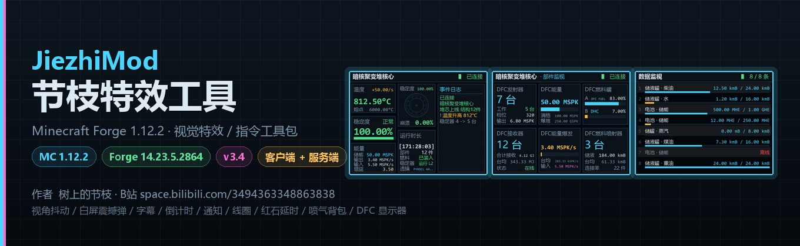
</div>

<h1 align="center">节枝特效工具 · JiezhiMod</h1>

<p align="center">
  <sub>仓库名 <code>DFC-Map-Creation-Tool</code> ｜ 构建产物 <code>jiezhi-1.12.2-dfcmaptools-3.8.jar</code> ｜ 模组 ID <code>jiezhimod</code></sub>
</p>

<p align="center">
  <a href="https://minecraft.net"></a>
  <a href="https://files.minecraftforge.net/net/minecraftforge/forge/index_1.12.2.html"></a>
  
  
  
  
</p>

<p align="center">
  给 <b>地图作者</b> 与 <b>短片作者</b> 用的一套 Minecraft 视觉特效工具包。<br>
  视角抖动 · 白屏震撼弹 · 字幕 · 倒计时 · 通知 · 聊天栏动效 · 线圈道具 · 红石延时器 · 喷气背包 · DFC 监控显示器
</p>

<p align="center">
  <b>作者：树上的节枝（jiezhi）</b> · B站 <a href="https://space.bilibili.com/3494363348863838">space.bilibili.com/3494363348863838</a>
</p>

---

## 📖 目录

- [这是什么](#-这是什么)
- [界面预览](#-界面预览)
- [功能总览](#-功能总览)
- [DFC 监控显示器（重头戏）](#-dfc-监控显示器重头戏)
- [物品：三种线圈 + 喷气背包 + DFC 遥控器](#-物品三种线圈--喷气背包--dfc-遥控器)
- [方块：红石延时器](#-方块红石延时器)
- [指令手册（详细）](#-指令手册详细)
- [安装](#-安装)
- [从源码构建](#-从源码构建)
- [目录结构](#-目录结构)
- [二创须知与署名要求](#-二创须知与署名要求)
- [常见问题](#-常见问题)
- [更新日志](#-更新日志)

---

## 🎯 这是什么

一个 **Minecraft Forge 1.12.2** 的模组，把做地图 / 拍短片时常用的那些"演出效果"打包成**一条指令就能调用**的东西：

- 想炸一下？`/shake @a 20 12` 全场抖屏。
- 想转场？`/white @a 30 1.0` 整屏爆白 + 余像。
- 想倒计时？`/countdown_add 6 bomb 30` 屏幕上方出现带进度条的高精度倒计时。
- 想推送公告？`/notice 副本开始 守住中央大厅` 右下角弹出圆角通知卡片。
- 想让玩家在反应堆旁边有一整面 4×3 的**实时监控大屏**？放下 DFC 显示器，拿遥控器绑一下核心就行。

所有特效都是**客户端渲染**（不改存档结构、不加实体），指令在**服务端注册**，所以**服务端与客户端都要装**。

> **不依赖任何其他模组**。DFC 显示器部分对 HBM 的核科技（NTM-CE）是**纯反射、软依赖**——装了就读数据，没装就显示 `NO LINK`，**不会崩**。

---

## 📸 界面预览

### DFC 监控显示器 —— 三种页面，同一台硬件

<table>
<tr>
<td width="33%">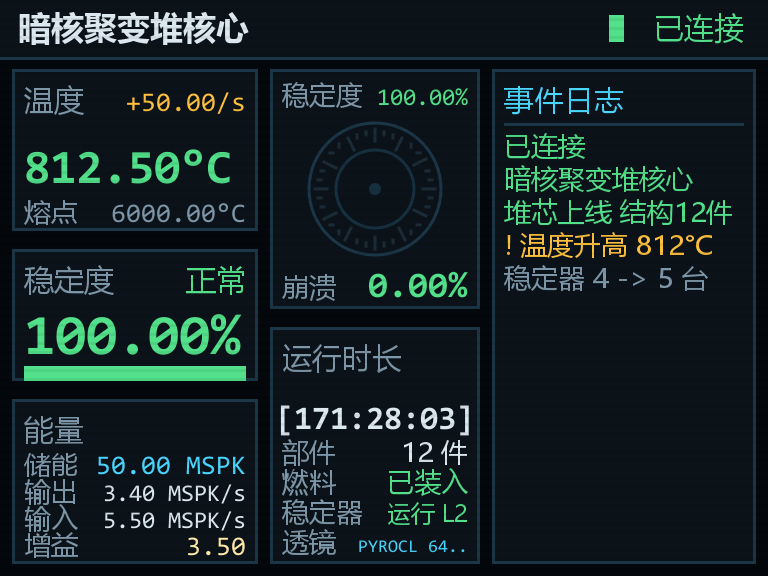<br><b>核心页</b>（DFC 监控显示器）</td>
<td width="33%">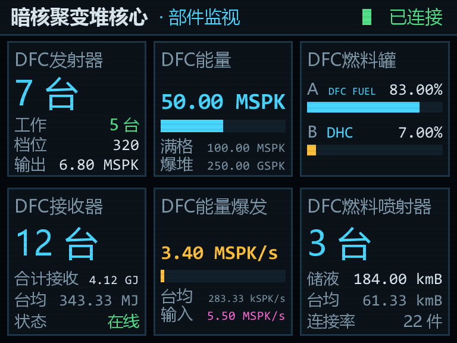<br><b>部件页</b>（DFC 部件监视器）</td>
<td width="33%">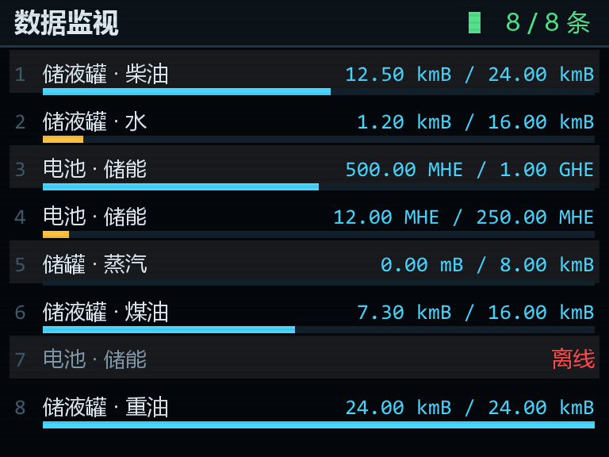<br><b>自定义页</b>（DFC 自定义显示屏）</td>
</tr>
</table>

### 开机流程与异常状态

<table>
<tr>
<td width="25%">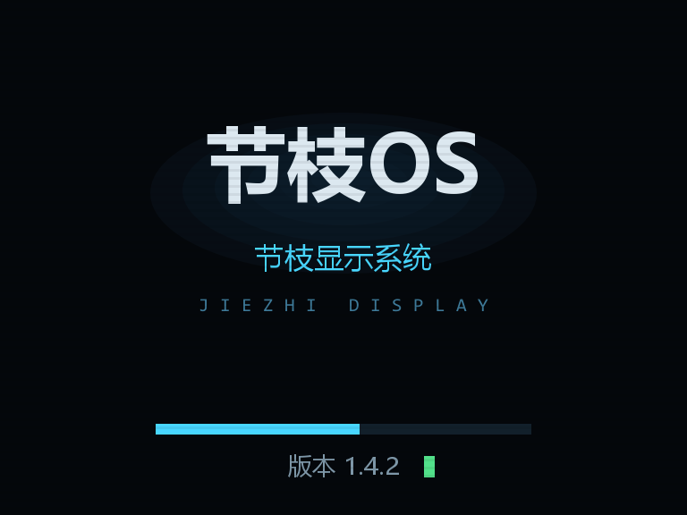<br>开机 · 节枝OS</td>
<td width="25%">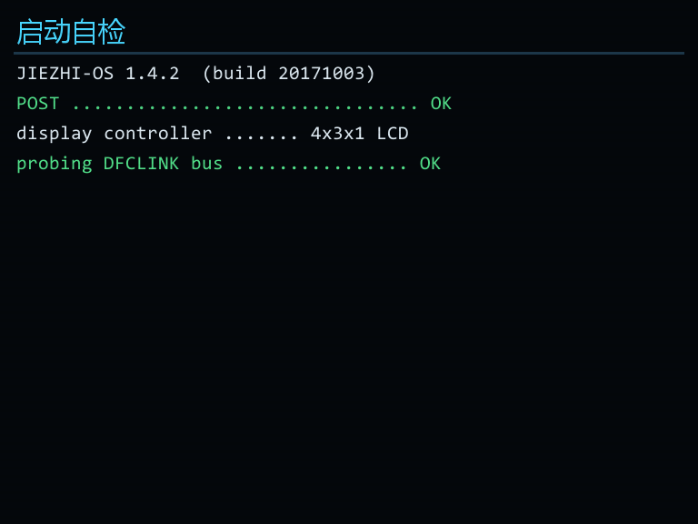<br>启动自检日志</td>
<td width="25%">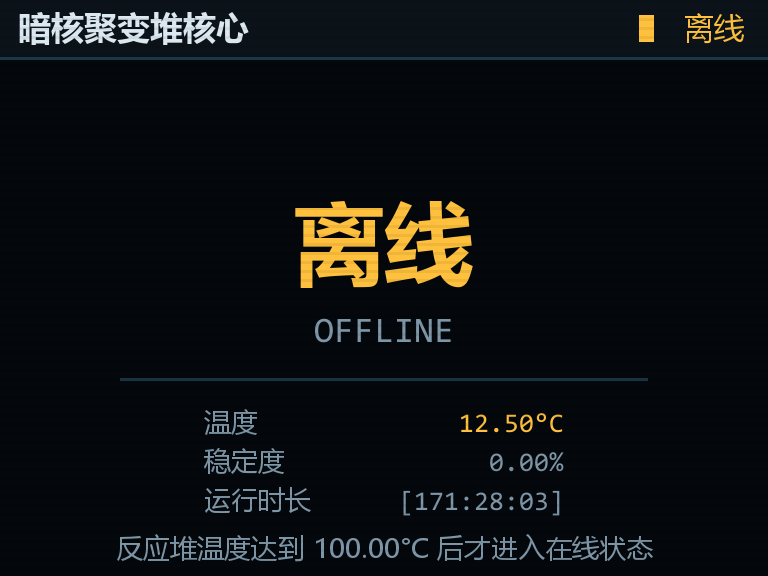<br>离线页（未到 100°C）</td>
<td width="25%">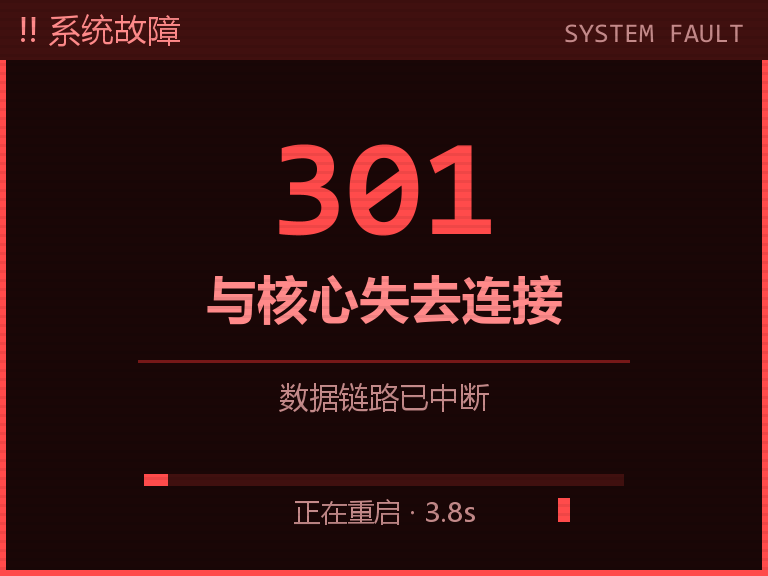<br>熔毁报错 301</td>
</tr>
</table>

### 崩溃圆盘（放大）

<table>
<tr>
<td width="50%">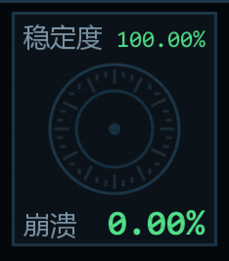<br>正常：环填充 = 坍缩度，顶部 = 稳定度</td>
<td width="50%">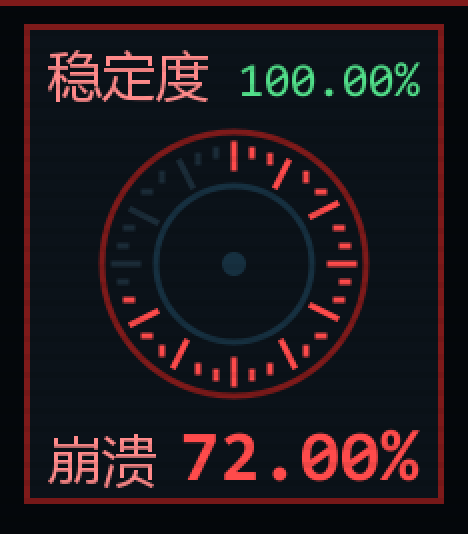<br>危急：整盘转红</td>
</tr>
</table>

### 物品与方块

<p align="center">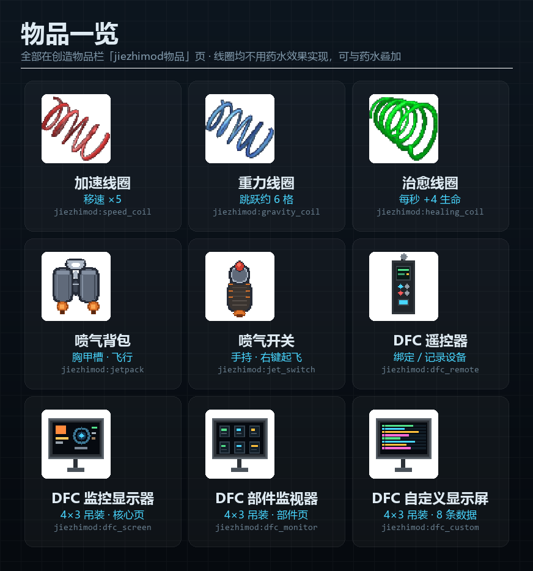</p>
<p align="center">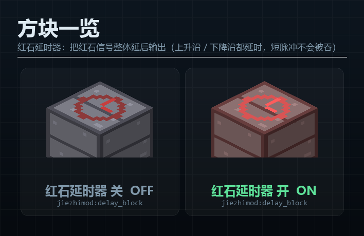</p>

---

## ✨ 功能总览

| 分类 | 内容 | 入口 |
|---|---|---|
| **镜头特效** | 视角抖动 `/shake`、白屏震撼弹 `/white` | 指令 |
| **文字特效** | 字幕 `/sub`、清空字幕 `/subtitleclear` | 指令 |
| **倒计时** | 6 种样式，支持十分之一秒精度与进度条，可红石检测 | `/countdown_*` |
| **通知** | 右下角圆角通知卡片 + 全屏历史界面 | `/notice`、`P` 键 |
| **聊天栏** | 消息弹起 / 滑出 / 滑入三套动画 | 自动生效 |
| **线圈道具** | 加速线圈、重力线圈、治愈线圈 | 创造物品栏「jiezhimod物品」 |
| **喷气背包** | 胸甲槽飞行 + 热量条 + 过热锁定 | 创造物品栏「jiezhimod物品」 |
| **红石延时器** | 信号整体延后输出，可设方向 | 创造物品栏「jiezhimod-红石」 |
| **DFC 显示器** | 监控显示器 / 部件监视器 / 自定义显示屏 + 遥控器 | 创造物品栏「DFC显示器」 |

<details>
<summary><b>展开：全部特性细节</b></summary>

#### 镜头与文字

- **视角抖动**：3 tick 起振冲峰 → 主震指数衰减 → `(1-r)^1.5` 余震收尾。噪声推进速度随强度变化（强震晃得快、余震晃得慢），结束后视角**精确回到原位**，不留偏移。
- **白屏震撼弹**：整屏纯白矩形，无暗角、无光晕、无放射光芒。强闪阶段叠加内置 `blur.json` 模糊；主闪结束后**自动追加 1~4.5 秒余像**（像视网膜残留一样慢慢消退），余像阶段关闭模糊。shader 加载失败或被占用时**静默降级**为纯白屏，不会崩。
- **字幕**：底部滑入 + 淡入，末尾淡出；支持 `\n` 换行、`\u00a7` 颜色码、双引号分组；多条字幕向上堆叠。

#### 倒计时（6 种样式）

| 样式 | 外观 | 特点 |
|---|---|---|
| 1 | `01:30` + 下方横线 | 最朴素，rgb 上色 |
| 2 | `\\\01:30///` | 固定红，斜杠从外向内逐个高亮 |
| 3 | `┌01:30┐` | rgb 描边框住时间 |
| 4 | `01:30.4` | 十分之一秒；10 秒内小数位转黄、3 秒转红 |
| 5 | `!01:30.4!` | 感叹号包裹；5 秒内感叹号脉冲、3 秒整体转红 |
| 6 | `01:30.4` + 进度条 | 条随剩余时间收缩，临近转黄转红 |

时间**向上取整**（3 秒立刻显示 `03`，最后 1 tick 仍显示 `00:01`）；**归零后不自动删除**，保留压暗的 `00:00`，这样 `/countdown_test 名称 0 0` 才能给红石"已结束"信号。

#### 通知与聊天栏

- **`/notice <标题> <正文...>`**：右下角圆角黑框，标题在上正文在下，停留 8 秒后右侧滑出淡出；同屏最多 6 条，历史保留 300 条。
- **`P` 键**：全屏通知历史界面，滚轮滑动、Esc 退出、显示接收时间。**任何界面打开时都不触发**，绝不会在打字时把聊天框顶掉。快捷键可在 `Options → Controls` 的 `jiezhimod` 分类改键。
- **聊天栏动效**：新消息从底部弹起，10 秒后向左滑出淡出；按 `T` 打开聊天时历史从左侧滑入，打开期间计时冻结，消息不会在你查看时消失。

#### 喷气背包

穿在**胸甲槽**，把**喷气开关**拿在手上，**按住右键**起飞、**松开右键**立刻失去动力。准星下方有热量条（绿→黄→橙），满了会**过热**，必须停下来冷却（降到 30% 以下）才能再次起飞。单次满燃料最多连续飞行 **18 秒**；跳跃键爬升、WASD 推进。

</details>

---

## 🖥 DFC 监控显示器（重头戏）

一块 **4 宽 × 3 高 = 12 格**的吊装多方块大屏，面朝斜下方，**下倾角由你放置时的视线俯仰决定**——对着天花板下表面放置就会垂挂在头顶俯视反应堆。

放下任意一格会**自动铺满 4×3**（空间不够则整体取消并返还物品），正面朝向玩家。屏幕顶部有吊架连着天花板，**右键开关机**。

### 三块屏，同一台硬件

| 方块 | 注册名 | 画哪一页 |
|---|---|---|
| **DFC 监控显示器** | `jiezhimod:dfc_screen` | **核心页** —— 反应堆实时数据 |
| **DFC 部件监视器** | `jiezhimod:dfc_monitor` | **部件页** —— 同类部件合并统计 |
| **DFC 自定义显示屏** | `jiezhimod:dfc_custom` | **自定义页** —— 最多 8 条自选数据 |

> 三块屏共用同一套 11 个占位方块，只是**控制器方块**不同；选页的判据就是控制器本身，所以三块屏可以并排装、互不干扰。

### 核心页

主界面实时显示暗核聚变堆（DFC）数据：**温度 / 熔点、稳定度、能量总线（SPK）、崩溃圆盘、运行时长、事件日志**。

- **崩溃圆盘**：外圈 36 格刻度环的填充 = **堆芯坍缩度**（0~1 的熔毁进度），顶部读数是**稳定度**，底部读数是**崩溃百分比**。一块盘只归一个量，互不重叠。
- **崩溃告警**：核心**一开始崩溃**（坍缩度 > 0）就整屏立刻转红、盘心变黄、顶栏闪烁 `!!` 并套一圈红边；坍缩过半后盘心进一步转红。未连接 / 离线时**一律不报警**。
- **离线判定**：反应堆**未到 100°C** 时整屏改画「离线」页，不会把一堆 0 当成正常读数。
- **事件日志**：放不下的长句**自动折行**，不截断、不显示省略号。

### 部件页

同类部件**合并显示**，不逐台罗列：

| 区块 | 内容 |
|---|---|
| DFC发射器 | 总台数 / 工作中台数 / 功率档位之和 / 合计打出 SPK |
| DFC接收器 | 总台数 / 合计已接收 / 台均 |
| DFC燃料罐 | A、B 两罐的流体名 + 液位条 + 百分比（不足 15% 变黄提醒加燃料） |
| DFC燃料喷射器 | 总台数 / 合计储液 / 台均 / 已连接部件总数 |
| DFC能量 | 当前存储 + 相对满刻度的进度条 |
| DFC能量爆发 | 核心当前每秒吐出的 SPK（含台均） |

### 自定义页 + DFC 遥控器

**右键打开面板 GUI**（不是直接开关机，开机按钮在 GUI 里）。面板上最多列 **8 条数据**，每条 = 一台设备的一项读数（含进度条）：

- **储罐**：流体名 + 当前液量 / 满量
- **电池**：当前储能 / 满量
- **模块化涡轮飞轮 / 叶片 / 轴 / 端口**：转速（rps）、输出功率

**接入方法（把遥控器放进面板的槽位，点「添加」）**

1. 拿 **DFC 遥控器**，**蹲下右键**一台设备 → 记录（支持储罐、电池、飞轮储能、涡轮部件）；
2. **右键**自定义显示屏 → 打开面板；
3. 把遥控器**放进面板左上的遥控器槽位**（Shift 点击或拖放都行）→ 槽位右边会显示「N/8 台」；
4. 点 **「添加」** → 遥控器记录到的设备**全部**接进来（面板满了或已接过的会自动跳过，并在聊天栏报数）。

关面板时槽里的遥控器**自动还给你**（装不下就掉在脚下），不会忘在屏里。**蹲下右键空气** = 清空遥控器的全部记录（反应堆源 + 设备列表）。

> 老手感仍在：手持遥控器**蹲下右键**本屏也能直接接入 —— 两条路走的是同一份导入实现，结果完全一致。

同一台重复记录会被忽略。GUI 列表每行右侧有「删除」按钮，底部有「清空」；设备被拆后本条显示**离线**而不是继续报假读数。

> **点不到设备？** 大桶模型会放大到好几格、9×9 叶片的准心也常常落在空处。遥控器会**顺代理链解到真实机器**（识别多方块外壳块），读不出还会**就近扫描 3 格**取最近的一台可读设备。蹲下右键认不出来时会明确告诉你原因（附近没有可读设备 / 这个方块读不出数据），不会毫无反应。

### 绑定反应堆源

拿 **DFC 遥控器**右键 **DFC 核心** 或 **DFC 稳定器**记录坐标，再右键显示器完成绑定。潜行右键空气可清空记录。未绑定数据源时所有读数显示 `--`，**不会把 0 当读数**误判成"正常 / 危急"。

### 全局显示规则（三块屏通用）

| 规则 | 说明 |
|---|---|
| **刷新率 0.05 秒** | 恰好 1 tick，数据与画面同一个节拍，不插值不滞后 |
| **所有数值保留 2 位小数** | 温度 / 能量 / 液量 / 百分比 / 变化率；时间类保持整数秒 |
| **运行时长温度归零清零** | 一停堆就重新计时 |
| **未到 100°C = 离线** | 整屏改画「离线」页 |
| **0 度 + 0 稳定度不显示危急** | 冷堆的 0% 是"没开机"，不是稳定度崩了 |
| **重新加载存档会重启所有屏幕** | 重进存档 / 换维度 / 重载区块后，屏幕重走一遍 `节枝OS → 自检 → 主界面` |
| **核心开始炸时整屏报错 301** | 坍缩度一离开 0（爆炸倒计时启动）就整屏改画「错误 301 · 与核心失去连接」，停留 **4 秒**后自动重启屏幕 |

> **单位说明**：DFC 的能量单位是 **SPK**（不是 HE）。面板口径与作者自己的 CoreGUI 完全一致：`Contained Energy` = 原始值 × 1000 + `SPK`，`Expelling Energy` 同族。

---

## 🎒 物品：三种线圈 + 喷气背包 + DFC 遥控器

<p align="center"></p>

| 物品 | 注册名 | 效果 |
|---|---|---|
| 加速线圈 Speed Coil | `jiezhimod:speed_coil` | 手持时移动速度 **×5** |
| 重力线圈 Gravity Coil | `jiezhimod:gravity_coil` | 手持时跳得更高，约 **6 格** |
| 治愈线圈 Healing Coil | `jiezhimod:healing_coil` | 手持时每秒回复 **4 点生命**（2 颗心） |
| 喷气背包 Jetpack | `jiezhimod:jetpack` | 胸甲槽装备，配合喷气开关飞行 |
| 喷气开关 Jet Switch | `jiezhimod:jet_switch` | 手持，按住右键起飞 |
| DFC 遥控器 DFC Remote | `jiezhimod:dfc_remote` | 绑定反应堆源 / 记录设备 |

三件线圈的共同点：**手持生效**（主手或副手都行，不用右键）、**不用药水效果实现**（没有粒子、没有 HUD 图标）、**可以和药水叠加**。

```
/give <玩家> jiezhimod:speed_coil
/give <玩家> jiezhimod:gravity_coil
/give <玩家> jiezhimod:healing_coil
```

<details>
<summary><b>数值口径</b></summary>

- **加速线圈**：给 `MOVEMENT_SPEED` 挂一个 `MULTIPLY_TOTAL` ×5 修饰符。和迅捷药水叠加（迅捷 I 时约 ×5.4）。属性由服务端权威同步，不会拉扯回弹。
- **重力线圈**：把跳跃初速度从原版 `0.42` 换成 `1.0075`，按 MC 离散物理算出来峰值正好 6.00 格（代入原版 0.42 得 1.2522 格，与公认原版跳跃高度一致，可作校准）。和跳跃提升药水叠加，线圈 + 跳跃提升 I ≈ 7.2 格。
- **治愈线圈**：服务端每秒 `heal(4.0F)`。想要 4 颗心（8 点/秒），把 `HealingCoilEffect.HEAL_PER_SECOND` 改成 `8.0F` 重编译即可。

</details>

---

## 🧱 方块：红石延时器

<p align="center"></p>

`jiezhimod:delay_block` —— 把红石信号**整体延后**一段时间再输出。上升沿和下降沿都延时，所以一段脉冲是"整段后移"，**不会被压扁也不会被吞掉**（1 tick 的短脉冲照样能穿过去）。

**右键打开设置界面**：

| 项目 | 说明 |
|---|---|
| 延时时间 | 数值 + `-` `-10` `+` `+10` 微调，最大 9999；换算后封顶 1200000 tick（约 16.7 小时） |
| 单位 | `tick` / `秒` / `分` 三选一 |
| 输出方向 | `向前(直通)` / `向左` / `向右` / `三向`，**全部以信号进入的那一面为基准** |
| 状态行 | 当前输入 / 输出电平，以及距离下一次翻转还剩多少 tick |

**输出方向跟信号进来的那一面走，和方块摆放朝向无关**——放下就能用，不用转方块：

| 信号从哪面进 | 向前（直通）出 | 向左出 | 向右出 |
|---|---|---|---|
| 北面 | 南面 | 东面 | 西面 |
| 南面 | 北面 | 西面 | 东面 |
| 东面 | 西面 | 南面 | 北面 |
| 西面 | 东面 | 北面 | 南面 |
| 上面 | 下面 | 下面（退化） | 下面（退化） |
| 下面 | 上面 | 上面（退化） | 上面（退化） |

信号从上面 / 下面进来时没有"左右"可言（竖直方向绕 Y 轴旋转无定义），此时左 / 右 / 三向统一退化成正对面输出。输入方向在**上升沿锁存**（同中继器），挪动线路后可以点界面上的"重检方向"。

```
/give <玩家> jiezhimod:delay_block
```

---

## ⌨️ 指令手册（详细）

> **权限等级统一为 2** —— OP 与命令方块都能执行。
> **省略 `[@target]` 时**：玩家自己执行 → 只作用于自己；控制台 / 命令方块执行 → 作用于所有在线玩家。
> 记号：`[ ]` 可省略，`< >` 必填，**粗体**为默认值。

### 速查表

| 指令 | 别名 | 作用 |
|---|---|---|
| [`/shake`](#shake--视角抖动) | `/cshake` | 视角抖动 |
| [`/white`](#white--白屏震撼弹) | `/whitescreen` | 白屏震撼弹（自动追加余像） |
| [`/sub`](#sub--字幕) | `/subtitle` | 屏幕上方字幕 |
| [`/subtitleclear`](#subtitleclear--清空字幕) | `/subclear`、`/clearsubtitle` | 立刻清空字幕 |
| [`/countdown_add`](#countdown_add--新增倒计时) | — | 新增 / 覆盖一个倒计时 |
| [`/countdown_remove`](#countdown_remove--删除) | `/countdown_re`、`/countdown_del` | 删除倒计时 |
| [`/countdown_stop`](#countdown_stop--暂停--countdown_continue--继续) | — | 暂停 |
| [`/countdown_continue`](#countdown_stop--暂停--countdown_continue--继续) | — | 继续 |
| [`/countdown_test`](#countdown_test--红石比较器读取) | — | 剩余秒数落在区间内 → 供红石比较器读取 |
| [`/notice`](#notice--右下角通知) | — | 右下角通知 |

---

### `/shake` —— 视角抖动

```
/shake [@target] <ticks> [intensity]
```

| 参数 | 必填 | 默认 | 范围 | 说明 |
|---|:--:|---|---|---|
| `@target` | | 见上 | 任意目标选择器 | 受影响的玩家 |
| `ticks` | ✅ | — | ≥ 1 | 持续时长，**20 ticks = 1 秒** |
| `intensity` | | **4.0** | 0 ~ 90 | 抖动幅度（度）。填 0 = 完全不抖 |

用**平滑噪声 + 三段式包络（主震 → 衰减 → 余震）**，观感是"镜头被震了一下"而不是随机抽搐；**不改变玩家最终的视角朝向**，抖完不会偏头。

```mcfunction
/shake 40                             # 自己抖 2 秒，默认强度
/shake @a 60 8                        # 全场抖 3 秒，强度 8
/shake @a[x=0,y=64,z=0,r=30] 20 2     # 只震半径 30 格内的玩家
```

---

### `/white` —— 白屏震撼弹

```
/white [@target] <ticks> [alpha]
```

| 参数 | 必填 | 默认 | 范围 | 说明 |
|---|:--:|---|---|---|
| `@target` | | 见上 | 任意目标选择器 | 受影响的玩家 |
| `ticks` | ✅ | — | ≥ 1 | **主闪**时长（20 ticks = 1 秒） |
| `alpha` | | **1.0** | 0.0 ~ 1.0 | 白屏不透明度，1.0 = 全白 |

主闪结束后会**自动追加 1 ~ 4.5 秒余像**（像视网膜残留一样慢慢消退）。模糊与散光**只出现在主闪阶段**，余像阶段是纯白渐隐 —— 低配机器也不会因为长余像掉帧。

```mcfunction
/white 30                             # 主闪 1.5 秒，满不透明
/white @a 20 0.6                      # 全场主闪 1 秒，60% 不透明
```

---

### `/sub` —— 字幕

```
/sub [@target] [ticks] <text...>
```

| 参数 | 必填 | 默认 | 说明 |
|---|:--:|---|---|
| `@target` | | 见上 | 受影响的玩家 |
| `ticks` | | **80**（4 秒） | 显示时长；**只有纯数字才会被当作时长**，否则整段都算正文 |
| `text...` | ✅ | — | 字幕正文。支持 `\n` 换行、`\u00a7` 颜色码、`"引号包起来"` |

```mcfunction
/sub 第一章 开始                        # 默认 4 秒
/sub @a 100 \u00a7c警告\u00a7r：反应堆过载
/sub @a 120 第一行\n第二行               # \n 会真的换行
```

---

### `/subtitleclear` —— 清空字幕

```
/subtitleclear [@target]
```

立刻清掉目标玩家**当前所有**字幕（不等自然结束）。别名 `/subclear`、`/clearsubtitle`。

```mcfunction
/subtitleclear @a
```

---

### `/countdown_add` —— 新增倒计时

```
/countdown_add <样式1-6> <名称> <秒数> [r] [g] [b]
```

| 参数 | 必填 | 默认 | 范围 | 说明 |
|---|:--:|---|---|---|
| `样式` | ✅ | — | 1 ~ 6 | 见下方[样式详解](#倒计时-6-种样式详解) |
| `名称` | ✅ | — | — | 标识符，后续 `_stop` / `_remove` / `_test` 都用它。**重名会直接覆盖** |
| `秒数` | ✅ | — | 1 ~ 999999 | 倒数时长 |
| `r` `g` `b` | | **255 255 255** | 0 ~ 255 | 颜色。**三个必须一起给**，只给一两个会被忽略 |

显示位置固定在**屏幕上方中央**，多个倒计时按添加顺序**从上往下排列**，每行 30 像素。

```mcfunction
/countdown_add 6 bomb 30 255 90 60    # 样式 6（带进度条），30 秒，橙红色
/countdown_add 1 准备 10               # 样式 1，10 秒，默认白色
```

---

### `/countdown_remove` —— 删除

```
/countdown_remove <名称>      别名：/countdown_re、/countdown_del
/countdown_stop <名称>        暂停（时间冻结，画面保留）
/countdown_continue <名称>    继续
```

```mcfunction
/countdown_stop bomb
/countdown_continue bomb
/countdown_remove bomb
```

---

### `/countdown_test` —— 红石比较器读取

```
/countdown_test <名称> <min> <max>
```

**剩余秒数落在 `[min, max]` 区间内时，命令方块可被红石比较器检测到信号**，区间外无信号。

- 归零后倒计时**保留为 00:00**（不会消失），所以 `min=max=0` 就是"已结束"这条信号；
- `remainingSeconds` 用**向上取整**，所以"剩 0.2 秒"也会先算成 1。

```mcfunction
/countdown_test bomb 0 5      # 最后 5 秒 → 有信号（接 /shake 做震动）
/countdown_test bomb 0 0      # 已结束     → 有信号（接 /white 做爆闪）
```

配套命令方块写法：`/countdown_test` 放在一个命令方块里（方块本身不做事，只做"探测器"），
再用红石比较器读取它 → 比较器 → 中继器 → 目标命令方块。

---

### `/notice` —— 右下角通知

```
/notice <标题> <正文...>
```

| 参数 | 必填 | 说明 |
|---|:--:|---|
| `标题` | ✅ | 第一行，粗体白字，单行不换行 |
| `正文...` | ✅ | 第二行起，**自动按卡片宽度折行** |

- 推给**所有在线玩家**；
- 停留 **8 秒**后向右滑出淡出（进入 0.28 秒、淡出 0.9 秒）；
- 同屏最多叠 **6 条**，**最新的在上方、先发的在下方**；超出一屏高度的旧通知会被自动让位；
- 卡片是**半透明黑底（约 80% 不透明）+ 1px 淡描边**，文字带阴影 —— 压在亮色方块或水面上也读得清；
- 卡片贴在**物品栏上方**（距屏幕底部 56 px），不会挡住快捷栏、经验条和血条；
- 历史保留 **300 条**，短按 **P** 打开通知历史界面（滚轮滑动、Esc 退出）。

```mcfunction
/notice 副本开始 第一阶段：\u00a7a守住中央大厅
/notice \u00a7c警告 \u00a7e30 秒后场地崩塌
```

---

### 倒计时 6 种样式详解

样式决定"时间怎么画"。`样式4/5/6` 是**高精度**样式，时间带十分之一秒（`mm:ss.t`），
小数位会随剩余时间变色；`样式1/2/3` 是整秒样式。

| 样式 | 时间格式 | 外观 | 颜色规则 | 临期表现 |
|:--:|---|---|---|---|
| **1** | `mm:ss` | 时间 + 下方一条横线 | 用你给的 rgb | 剩余 ≤ 100 ticks（5 秒）整行脉冲放大 |
| **2** | `mm:ss` | `\\\时间///`，两侧斜杠包裹 | **固定红色**，忽略 rgb | 斜杠从外向内逐个点亮 |
| **3** | `mm:ss` | 时间被一个方框圈住 | 用你给的 rgb | 剩余 ≤ 100 ticks 整行脉冲放大 |
| **4** | `mm:ss.t` | 纯高精度时间 | 主体 rgb；**≤ 10 秒小数位转黄**，**≤ 3 秒转红** | 小数位颜色即是提醒 |
| **5** | `!mm:ss.t!` | 高精度时间被感叹号包裹 | 主体 rgb；≤ 3 秒整体转红 | **≤ 5 秒**感叹号脉冲闪动 |
| **6** | `mm:ss.t` | 高精度时间 + **下方进度条** | 条的颜色从 rgb 渐变到黄、再转红；≤ 3 秒红色呼吸 | 条随剩余时间收缩，一眼看出还剩多少比例 |

- 进度条宽度 = 屏幕宽度的 **28%**（夹在 64 ~ 180 px），高 3 px，带外框与暗色轨道；
- `样式6` 的进度条分母是**添加时设定的总秒数**，所以暂停时条会停住而不是回缩；
- 所有样式在**结束后**都会整体变灰（45% 亮度）保留在 00:00，方便 `/countdown_test` 检测"已结束"。

```mcfunction
/countdown_add 1 ready 10                     # 样式1：10 秒，白色 + 横线
/countdown_add 2 alarm 30                     # 样式2：红色斜杠，30 秒
/countdown_add 3 locked 60 255 200 60         # 样式3：橙黄方框，1 分钟
/countdown_add 4 precise 45 120 200 255       # 样式4：高精度，天蓝
/countdown_add 5 tense 20 255 120 180         # 样式5：感叹号包裹，粉紫
/countdown_add 6 bomb 30 255 90 60            # 样式6：带进度条，橙红（最推荐做"爆炸倒计时"）
```

---

### 目标选择器

`@p` 最近玩家 · `@a` 所有玩家 · `@r` 随机玩家 · `@e` 所有实体 · `@s` 自己

高级参数（可组合）：

| 参数 | 含义 |
|---|---|
| `c=3` | 最多选 3 个 |
| `lm=5` | 只选"游戏模式为 5"（1.12.2 里 `lm` 是游戏模式过滤，`m=` 亦可） |
| `team=red` | 只选红队 |
| `x= y= z=` | 以该点为中心 |
| `r=30` | 半径 30 格以内 |

```mcfunction
@a[x=100,y=64,z=100,r=50]        # 坐标 ±50 格内的所有玩家
@a[c=1]                          # 只作用于 1 个人（通常配合 @r 用）
```

---

### 颜色码

1.12.2 的聊天框打不出分节号 `§`，所以**写 `\u00a7`**（模组会自动转成真正的分节号）：

| 写法 | 效果 | 写法 | 效果 |
|---|---|---|---|
| `\u00a7c` | 红 | `\u00a7e` | 黄 |
| `\u00a7a` | 绿 | `\u00a76` | 金 |
| `\u00a79` | 蓝 | `\u00a7l` | **粗体** |
| `\u00a7b` | 青 | `\u00a7r` | 重置 |

```mcfunction
/sub @a 80 \u00a7c红色标题 \u00a7a绿色副标题
/notice \u00a76金色标题 正文用默认色
```

---

## 🚀 安装

1. 安装 **Minecraft 1.12.2** 与 **Forge 14.23.5.2864**；
2. 把 `jiezhi-1.12.2-dfcmaptools-3.8.jar` 放进 `.minecraft/mods/`（**服务端也要放**，特效靠网络包下发）；
3. 启动游戏，日志里出现 `jiezhi` 大字 LOGO 与 `JiezhiMod v3.8 is loading.` 即加载成功；
4. 进世界输入 `/shake 40` 自验。

> **服务端必须装**：指令在服务端注册，画面在客户端渲染。只装服务端能注册指令但看不到特效，只装客户端则连指令都没有。

---

## 🔧 从源码构建

### 环境

| 依赖 | 版本 |
|---|---|
| JDK | **21**（编译目标仍是 Java 8） |
| Gradle | 由 `gradlew` 自带 |
| ProGuard | **7.4.2**（本地构建需要，需自行下载到 `tools/proguard-7.4.2/`） |

```
git clone https://github.com/<你的用户名>/<仓库名>.git
cd <仓库名>
```

### 构建三步（缺一不可）

```bat
:: 1. 编译出基础 jar
gradlew.bat build --offline
::    -> build\libs\jiezhi-1.12.2-dfcmaptools-3.8.jar

:: 2. ProGuard 混淆
java -jar tools\proguard-7.4.2\lib\proguard.jar @tools\proguard.pro
::    -> tools\obf.jar

:: 3. 注入完整性封印（内含 ASM StackMapTable 补帧 + SealA/SealB 哈希注入）
python tools\seal_inject.py tools\obf.jar build\libs\jiezhi-1.12.2-dfcmaptools-3.8.jar
```

**为什么必须三步全跑？** jar 内置**双重完整性校验**：业务类的聚合哈希在构建期被固化进 Seal，运行时校验不过就直接崩溃。所以改了源码却不重跑三步，进游戏必定 `integrity check failed`。**纯资源改动（贴图 / mcmod.info / 语言文件）也要重跑**。

### 构建后必验

```bat
python tools\check_stackmap.py build\libs\jiezhi-1.12.2-dfcmaptools-3.8.jar   :: 期望输出 OK
python tools\selftest\run_selftest.py                                        :: 期望 ALL GREEN
:: 编译并运行 tools\testmain\TestMain.java，期望输出 SEAL OK
```

### 辅助开发工具

| 工具 | 用途 |
|---|---|
| `tools\canvastest\run_dump.bat` | **不进游戏**，离屏渲染三块屏的任意页面为 PNG（README 里的配图就是这么来的） |
| `tools\selftest\` | 离线断言测试（格式化 / 序列化 / 版式哨兵 / 注册检查） |
| `tools\testmain\` | Seal 完整性自检 |
| `tools\gen_readme_assets.py` | 生成 `screenshots/` 下的横幅与物品 / 方块一览图 |

---

## 📁 目录结构

```
.
├── build.gradle                    # ForgeGradle 3.x 构建脚本
├── gradle.properties               # Gradle JVM 参数
├── screenshots/                    # README 配图
├── docs/                           # 详细文档
│   ├── 使用文档.md                  # 完整玩法手册
│   ├── DFC显示器.md                 # DFC 三块屏专题
│   ├── 构建指南.md                  # 构建与防篡改架构
│   └── 常见问题.md
├── src/main/java/com/jiezhimod/
│   ├── JiezhiMod.java              # @Mod 入口
│   ├── block/                      # 方块：红石延时器、DFC 显示屏（控制器 + 占位块 + 多方块逻辑）
│   ├── item/                       # 物品：线圈、喷气背包、DFC 遥控器
│   ├── command/                    # 全部指令
│   ├── client/                     # 客户端渲染：特效、聊天栏、通知、DFC 画布
│   │   └── dfc/                    # 屏幕画布与版式（ScreenCanvas / ScreenLayout / ScreenFonts）
│   ├── dfc/                        # 数据层：快照、数据槽、格式化、反射桥、结构几何
│   ├── network/                    # 网络包（SimpleNetworkWrapper）
│   ├── countdown/                  # 服务端倒计时管理
│   ├── proxy/                      # CommonProxy / ClientProxy（类名不可混淆）
│   └── seal/                       # 完整性校验（SealA / SealB / Str）
├── src/main/resources/
│   ├── mcmod.info                  # 游戏内说明（玩家看到的指令手册）
│   └── assets/jiezhimod/           # 贴图 / 模型 / 语言文件 / 音效
└── tools/                          # 构建与开发工具（见上表）
```

---

## ⚠️ 二创须知与署名要求

**本仓库以「源码公开」的形式发布，但不是无限制许可。** 简而言之：

- ✅ **可以**：阅读、学习、编译自用、在自己整合包里使用、向本仓库提 PR。
- ✅ **可以**：基于本模组做二次创作（改数值、改贴图、加功能、做附属）。
- ❗ **必须**：**任何二次创作、修改版、转载、整合包分发，都必须显著保留原作者的署名**
  —— **「树上的节枝」**（附带 B 站主页 `https://space.bilibili.com/3494363348863838`），
  并注明本项目链接。署名需出现在**项目说明（README / 页面介绍 / 整合包清单 / 模组列表）**中，不能只写在源码注释里。
- ❌ **不可以**：删除或替换原作者署名后分发；把本模组或其修改版**当作自己的作品**发布。
- ❌ **不可以**：直接**二次分发本模组的 jar 或修改版 jar**（请引导用户回到本仓库 / 原作者发布页下载）。整合包内置需先取得作者同意。
- ❌ **不可以**：**商业用途**（售卖、付费墙、收费整合包等）。

完整条款见 [LICENSE.md](LICENSE.md)。**署名是本许可的核心条件，请务必遵守。**

---

## ❓ 常见问题

<details>
<summary><b>装好了但指令用不了 / 特效没反应？</b></summary>

- 特效指令权限等级是 **2**，需要 OP 或命令方块执行。
- **客户端与服务端都要装**：只装服务端能注册指令但看不到画面；只装客户端连指令都没有。
- 单人游戏里集成服务器也会注册指令，所以客户端装了就能用。

</details>

<details>
<summary><b>DFC 显示器显示 `NO LINK` / 一堆 `--`？</b></summary>

说明这台屏还没绑定数据源。拿 **DFC 遥控器**右键 **DFC 核心**或 **DFC 稳定器**记录坐标，再右键显示器完成绑定。
屏幕用**纯反射**读 HBM 的数据，**没装 HBM 的核科技（NTM-CE）时不会崩**，只会显示 `NO LINK`。

</details>

<details>
<summary><b>DFC 显示器整屏是「离线」页？</b></summary>

反应堆温度**没到 100°C** 就按离线处理（冷堆的 0 只是"没开机"）。等核心升温到 100°C 以上就会切回主界面。

</details>

<details>
<summary><b>遥控器蹲下右键设备没反应？</b></summary>

现在会**明确告诉你原因**：附近没有可读设备，或者这个方块读不出数据（会报类名）。
如果对着大桶 / 9×9 叶片点不准，遥控器会自动解多方块代理链、并就近扫描 3 格，记下的是**设备自己的坐标**。

</details>

<details>
<summary><b>倒计时归零后 `00:00` 一直挂着？</b></summary>

这是刻意的，方便 `/countdown_test 名称 0 0` 检测"已结束"。用 `/countdown_remove 名称` 清掉即可。

</details>

<details>
<summary><b>模组启动就崩溃，报 `integrity check failed`？</b></summary>

jar 内置完整性校验，说明文件被改动过（反编译、二次打包、解压改动都会触发）。请从**官方发布页**重新下载完整 jar。
如果你是从源码自己构建的，请确认**三步构建全部重跑过**。

</details>

<details>
<summary><b>白屏时画面没模糊？</b></summary>

余像阶段（主闪结束后）故意关闭模糊以模拟视力恢复；另外若内置 shader 被其他模组占用或资源缺失，会静默降级为纯白屏。

</details>

<details>
<summary><b>聊天栏动效失效了？</b></summary>

接管方式是客户端初始化时把 `GuiIngame` 里的聊天实例换成本模组的子类；若另一个模组在之后又换了一份，以最后换的为准。反射替换失败时本模组会保留原版聊天（不会崩），只是没有动效。

</details>

---

## 📜 更新日志

摘要（完整版见 [CHANGELOG.md](CHANGELOG.md)）：

- **3.8** —— 面板底色仍不可见，根因是自绘填充走 `disableTexture2D() + POSITION_COLOR`（HBM 会直接改 GL 状态，`GlStateManager` 纹理缓存失同步时这条路等于没画）。改走**和文字完全相同**的路径：绑自带纯白纹理 + `POSITION_TEX_COLOR`；面板底色改为**完全不透明**；新增 `[GuiCustomScreen]` / `[GuiDraw]` 排错日志；修掉自测脚本"永远在验最老 jar"的 bug。
- **3.7** —— 修好「面板底色是透明的」：`GuiDraw` 的三角化写错（圆角路径的中心点只发一次、方角路径的三角形全是零面积），**底色 / 斑马纹 / 物品格子从来没画出来过**。几何抽到 `GuiGeometry` 并补 10 条几何自测。连带修好延迟方块 GUI、通知列表、热量条、通知 HUD 的底纹。
- **3.6** —— 自定义显示屏面板**版面重做**：高度 306 → **240**（旧的比屏幕还高，标题被顶出屏幕、「清空/关闭」压到快捷栏上）；改成「左控制区 + 右数据列表」，修掉「遥控器」那一行的三重遮挡与底部提示被按钮切半；面板底色改 98% 不透明，挡住世界屏幕上透出来的引导文字。新增离屏版面预览工具 `tools/gui_mock/`。
- **3.5** —— 修复喷气背包「按住右键不能飞」（`setActiveHand` 从未被调用）与飞行方向不跟随视线；自定义显示屏改为**把遥控器放进面板槽位后点「添加」**接入设备；**物品 / 方块 / 物品描述全部中文化**（43 条文案走语言文件）；通知抬到物品栏上方、收窄并加深色底；README 补全指令手册与倒计时样式详解。
- **3.4.x** —— DFC 显示器全面重做：三块屏（核心页 / 部件页 / 自定义页）、崩溃告警、熔毁报错 301、存档重载重启屏幕、事件日志折行、单位对齐 SPK、部件页改用游戏官方中文名；通知历史快捷键改为 `P`；修复红石延时器方块不可见。
- **3.4** —— 聊天栏动画时钟改为按真实时间推进、过期只淡出不删除、堆叠顺序对齐原版；通知快捷键 `N` → `Ctrl/Shift + N`。
- **1.1** —— 新增倒计时样式 4/5/6、白屏余像、三件线圈、`/notice`、红石延时器、聊天栏动效。
- **1.0** —— 视角抖动、白屏震撼弹、字幕、倒计时样式 1~3。

---

## 🙏 致谢

- **MinecraftForge** 团队 —— 这个模组的地基。
- **HBM 的核科技（NTM-CE，尤其是 Cursed Edition / leafia 的 DFC 扩展）** —— DFC 显示器读取的所有数据都来自它。本模组对它是**纯反射的软依赖**，没有引用任何它的类。
- 所有提交 issue / 反馈 bug 的玩家。

---

<p align="center">
  <b>作者：树上的节枝</b> · <a href="https://space.bilibili.com/3494363348863838">B站主页</a><br>
  <sub>本项目以「源码公开 + 署名非商业」形式发布，二次创作请务必保留「树上的节枝」署名。</sub>
</p>
