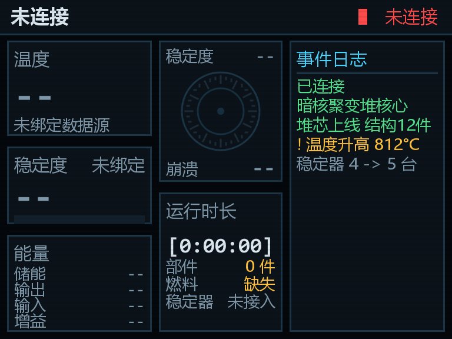
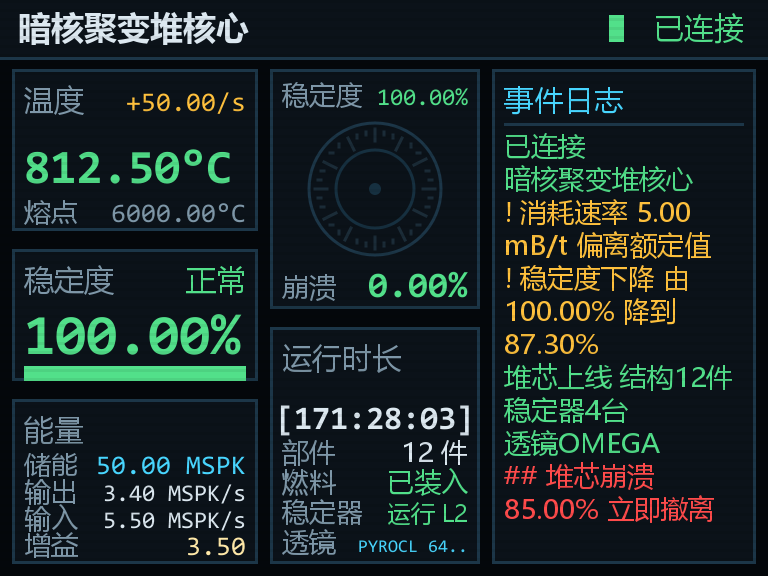
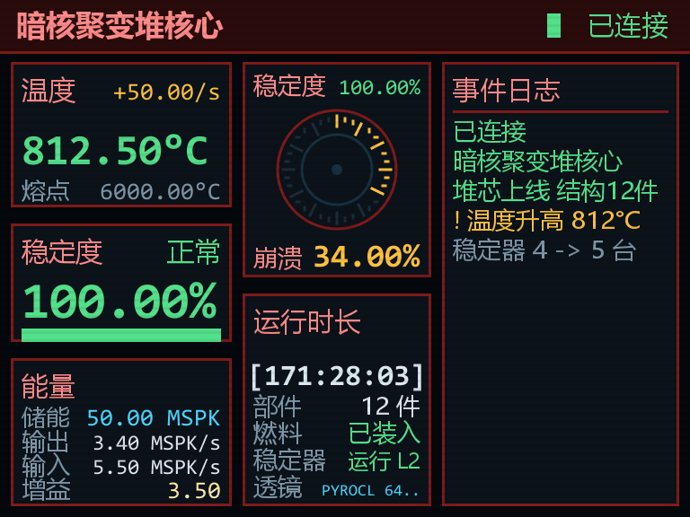
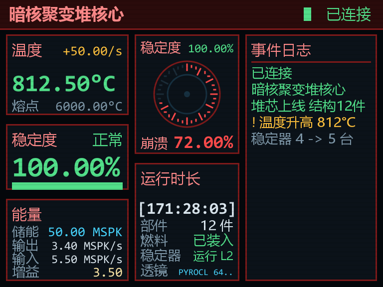
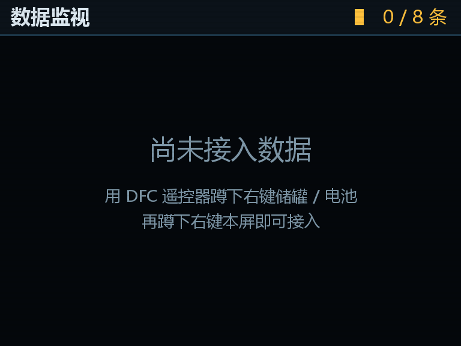

# DFC 监控显示器 · 完整说明

> 版本 **3.5** ｜ Minecraft **1.12.2** ｜ Forge **14.23.5.2864**
> 作者：树上的节枝（jiezhi） · B站：<https://space.bilibili.com/3494363348863838>

---

## 1. 这是什么

一套 **4 宽 × 3 高** 的吊装多方块大屏，用来在游戏里实时监控 HBM 的核科技（NTM-CE）**暗核聚变堆（DFC）**。

三块屏**共用同一台硬件**，只是控制器方块不同，各画一页：

| 方块 | 注册名 | 画哪一页 | 主要看什么 |
|---|---|---|---|
| DFC 监控显示器 | `jiezhimod:dfc_screen` | 核心页 | 温度 / 稳定度 / 能量 / 崩溃 / 运行时长 / 事件 |
| DFC 部件监视器 | `jiezhimod:dfc_monitor` | 部件页 | 发射器 / 接收器 / 燃料罐 / 喷射器的合计统计 |
| DFC 自定义显示屏 | `jiezhimod:dfc_custom` | 自定义页 | 自己挑的最多 8 条设备读数 |


> **软依赖**：屏幕用**纯反射**读取 HBM 的数据，**没有引用任何 HBM 的类**。没装 NTM-CE 时屏幕显示 `NO LINK`，**不会崩**。

---

## 2. 摆放与开关

### 2.1 摆放

- 放下**任意一格**会自动铺满旁边的 **4×3** 共 12 格；空间不够则**整体取消并返还物品**。
- 屏幕**正面朝向玩家**。
- **下倾角跟随你放置瞬间的视线俯仰**——对着**天花板下表面**放置，就会向下垂挂在头顶，正好俯视下方的反应堆。
- 屏幕顶部有吊架连着天花板。

### 2.2 开关

| 屏幕 | 交互 |
|---|---|
| 监控显示器 / 部件监视器 | **右键**开 / 关机 |
| 自定义显示屏 | **右键打开 GUI**（开机按钮在 GUI 里） |

开机后依次播放：**节枝OS 启动画面 → 启动自检日志 → 主界面**。


---

## 3. 绑定反应堆源

监控显示器 / 部件监视器需要知道"看哪一台堆"，用 **DFC 遥控器**绑定：

1. 拿 **DFC 遥控器**，右键 **DFC 核心**或 **DFC 稳定器** → 记录坐标；
2. 再**右键显示器** → 完成绑定；
3. **蹲下右键空气** → 清空记录。

> 记录稳定器时屏幕会自动解析出它对应的核心。

未绑定 / 绑定的机器被拆掉时，所有读数显示 `--`，而不是显示 0。



---

## 4. 核心页


### 4.1 左栏

| 区块 | 内容 |
|---|---|
| 温度 | 当前温度 + 熔点 + 相对熔点的情况 |
| 稳定 | 稳定度百分比 + 进度条 |
| 能量 | 储能（SPK）/ 输出 / 输入 / 增益 |
| 运行时长 | 从本次升温开始计时，温度归零后清零 |

### 4.2 中栏：崩溃圆盘

一块表盘**只归一个量**：

| 位置 | 含义 |
|---|---|
| **圆盘刻度环的填充** | **堆芯坍缩度**（0~1 的熔毁进度），36 格逐格点亮，颜色 绿 → 黄 → 红 |
| **顶部读数** | **稳定度**百分比 |
| **底部读数** | **崩溃**百分比 |

盘心不放数字、也不放指针——早期版本把百分比放在盘心（15 号字），而盘心那个填充圆的宽度只有它的三分之一，一串数字直接横穿同心圆环。现在改为三条互不重叠的横带。


### 4.3 右栏：事件日志

按时间顺序记录状态变化（堆芯上线、稳定度下降、消耗速率偏离额定值、熔毁倒计时……），**放不下的长句自动折行**，不截断、不显示省略号。



### 4.4 崩溃告警

**核心一开始崩溃（坍缩度从 0 跳到 > 0）就整屏立刻转红**：

- 整屏主题转为告警红，外圈套一圈红边；
- 圆盘盘心立刻变黄，**坍缩过半后进一步转红**；
- 顶栏闪烁 `!!` 告警标记。

未连接、离线时**一律不报警**（避免假警报）。




### 4.5 离线页

反应堆**温度未到 100°C** 时，整屏改画「离线」页。理由：冷堆的 0 只是"没开机"，不是真实读数。


### 4.6 熔毁报错 301

**坍缩度一离开 0**（也就是作者代码里 `explosionIn` 开始倒计时的那一刻 = "核心开始炸"），整屏改画全屏报错页：

```
!! 系统故障 / SYSTEM FAULT
        301
   与核心失去连接
   数据链路已中断
   正在重启 · 3.8s   [进度条]
```

停留 **4 秒**后**自动重启屏幕**——重新走一遍「节枝OS → 自检 → 主界面」，而不是凭空跳回主界面。


---

## 5. 部件页


同类部件**合并显示**，不逐台罗列：

| 区块 | 内容 |
|---|---|
| **DFC发射器** | 总台数 / 工作中台数 / 功率档位之和 / 合计打出 SPK |
| **DFC接收器** | 总台数 / 合计已接收 / 台均 |
| **DFC燃料罐** | A、B 两罐的流体名 + 液位条 + 百分比（**不足 15% 变黄**提醒加燃料） |
| **DFC燃料喷射器** | 总台数 / 合计储液 / 台均 / 已连接部件总数 |
| **DFC能量** | 当前存储 + 相对满刻度的进度条 |
| **DFC能量爆发** | 核心当前每秒吐出的 SPK（含台均） |

> 标题一律使用**游戏语言文件里的官方中文名**（暗核聚变堆核心 / DFC稳定器 / DFC发射器 / DFC接收器 / DFC燃料罐 / DFC燃料喷射器）。

---

## 6. 自定义页


**右键打开面板 GUI**（不是直接开关机）。面板上最多列 **8 条数据**，每条 = 一台设备的一项读数（含进度条）。

### 6.1 支持哪些设备

| 设备类型 | 读出的内容 |
|---|---|
| 储罐 / 储液罐（含大桶） | 流体名 + 当前液量 / 满量 |
| 电池 / 飞轮储能（FEnSU 等） | 当前储能 / 满量 |
| 模块化涡轮部件（飞轮 / 叶片 / 轴 / 端口） | 转速（rps）、输出功率 |

### 6.2 怎么接入

1. 拿 **DFC 遥控器**，**蹲下右键**一台设备 → 记录该设备；
2. **右键**自定义显示屏 → 打开面板；
3. 把遥控器**放进面板左上的遥控器槽位** → 槽位右边会显示「N/8 台」；
4. 点 **「添加」** → 遥控器里记录的设备**一次性全部接入**；
5. 关面板时槽里的遥控器**自动还给你**；**蹲下右键空气** → 清空遥控器的全部记录（反应堆源 + 设备列表）。

> 老手感仍在：手持遥控器**蹲下右键**本屏也能直接接入。两条路调用的是同一个
> `TileCustomScreen.importDevices(...)`，所以结果必然一致 —— 不会出现"右键接入 3 条、
> GUI 添加只进 2 条"这种对不上的情况。

同一台设备重复记录会被忽略。凑够 8 条后再记录新的会被拒绝。



### 6.3 GUI

面板从下往上依次是（坐标常量集中在 `ContainerCustomScreen`，GUI 引用同一份，不会错位）：

| 位置 | 功能 |
|---|---|
| 顶部 | 标题 + 开机 / 关机按钮，以及当前开关状态 |
| 左区 | **遥控器槽位**（只收 DFC 遥控器，1 格）+「遥控器」标签 +「N/8 台」+「添加」按钮 |
| 列表 | 8 行，每行 = 设备名 · 读数名 · 值 · 右侧「删除」按钮 |
| 下部 | 提示文字（自动折行） |
| 按钮行 | 「清空」/「关闭」 |
| 最底 | 玩家背包 3×9 + 快捷栏 |

**交互约定**

- 没放遥控器时「添加」是**灰的** —— 免得点一下没反应让人以为坏了；
- 遥控器放进槽位后，面板实时显示它记录了几台（遥控器的 NBT 本来就随槽位同步到客户端）；
- 点「添加」后服务端自己从 `player.openContainer` 里取那支遥控器来导入 ——
  网络包只发"我要添加"四个字，客户端伪造不了一个它没持有的物品；
- **关面板必定归还遥控器**（装不下掉脚下）。遥控器槽不写进方块实体 NBT，
  所以拆屏 / 炸屏不存在"里面的东西去哪了"的问题。

设备被拆掉后该条显示**离线**，而不是继续报假读数。

### 6.4 点不到设备？

- **流体大桶**的模型会放大到好几个方块，准心落在桶身上时射线命中的其实是**背后那一格**；
- **模块化涡轮**的叶片 / 飞轮是 **9×9** 大平面，准心也常常落在空处。

遥控器因此做了两件事：

1. **代理解链**：识别多方块外壳块（HBM 的多方块只有"核心"格挂真 TE，外壳格挂代理），顺 `cachedPosition` + `getTE()` 解到真实机器（≤3 跳、防自环）；
2. **就近扫描**：解不出数据就扫周围 **3 格**，取**最近的一台可读设备**。

记录的是**设备自己的坐标**，不是被点到的那一格——所以屏幕刷新时会直接打到真机器上。

**识别失败时会给明确提示**，两种情况分开说：

- `no readable device within 3 blocks` —— 附近真的没有可读设备；
- `unsupported block: <类名>` —— 这个方块有数据但我们读不了。

不会出现"蹲下右键毫无反应"这种让人以为模组坏了的情况。

---

## 7. 全局显示规则（三块屏通用）

| 规则 | 说明 |
|---|---|
| **刷新率 0.05 秒** | 恰好等于 1 tick，数据与画面同一个节拍，不插值不滞后 |
| **所有数值 2 位小数** | 温度 / 能量 / 液量 / 百分比 / 变化率；**时间类保持整数秒** |
| **运行时长温度归零清零** | 一停堆就重新计时 |
| **未到 100°C = 离线** | 整屏改画「离线」页 |
| **0 度 + 0 稳定度不显示危急** | 冷堆的 0% 是"没开机"，不是稳定度崩了 |
| **重新加载存档会重启所有屏幕** | 重进存档 / 换维度 / 重载区块后重走开机流程 |
| **核心开始炸时整屏报错 301** | 坍缩度离开 0 即触发，4 秒后自动重启屏幕 |

---

## 8. 单位口径（重要）

DFC 的能量单位是 **SPK**，**不是 HE**。面板与作者自己的 CoreGUI 完全一致：

| 作者原名 | 面板显示 | 换算 |
|---|---|---|
| `Contained Energy` | 储能 | `getDFCContainedEnergy() × 1000` + `SPK` |
| `Expelling Energy` | 输出 | 同族原始值，按速率显示为 `MSPK/s` |
| `incomingSpk` / `expellingSpk` | 输入 / 输出 | 同上，×1000 = SPK |
| `Potential Gain` | 增益 | 1 起步的倍率（不是能量） |
| `Stabilization` | 稳定度 | 累加值 ÷ 10 = 0~1 饱满度 |

> `getDFCMaxEnergy()` 返回写死的 `10000`，而且作者整个 mod **从未调用过**（HBM 遗留死常量）——所以它**不能**当满刻度。作者自己的进度条用的是 `/100000`，面板沿用同一口径。

---

## 9. 常见问题

**Q：屏幕显示 `NO LINK`？**
没装 HBM 的核科技（NTM-CE），或者装了但屏幕还没绑定数据源。前者无法解决（就是没数据），后者拿遥控器绑一下即可。

**Q：整屏是「离线」页？**
反应堆温度没到 100°C。等升温到 100°C 以上就会切回主界面。

**Q：屏幕是黑的？**
按右键开机（自定义屏则在 GUI 里点"开机"）。另外重新加载存档后屏幕会自动重启一遍，稍等两三秒。

**Q：换了服务器版本 / 作者的类名变了会怎样？**
屏幕是纯反射读取，读不到就显示 `--` 或 `离线`，**不会崩**。如果发现某项数据一直是 `--`，可能是 HBM 版本差异，欢迎提 issue。

**Q：三块屏可以挨着放吗？**
可以。选页的判据是**控制器方块本身**，三块屏互相独立。

**Q：自定义屏最多 8 条，能不能多接几台？**
不能。屏幕版面就那么大，8 条是上限。可以并排放第二块屏，各接各的。
